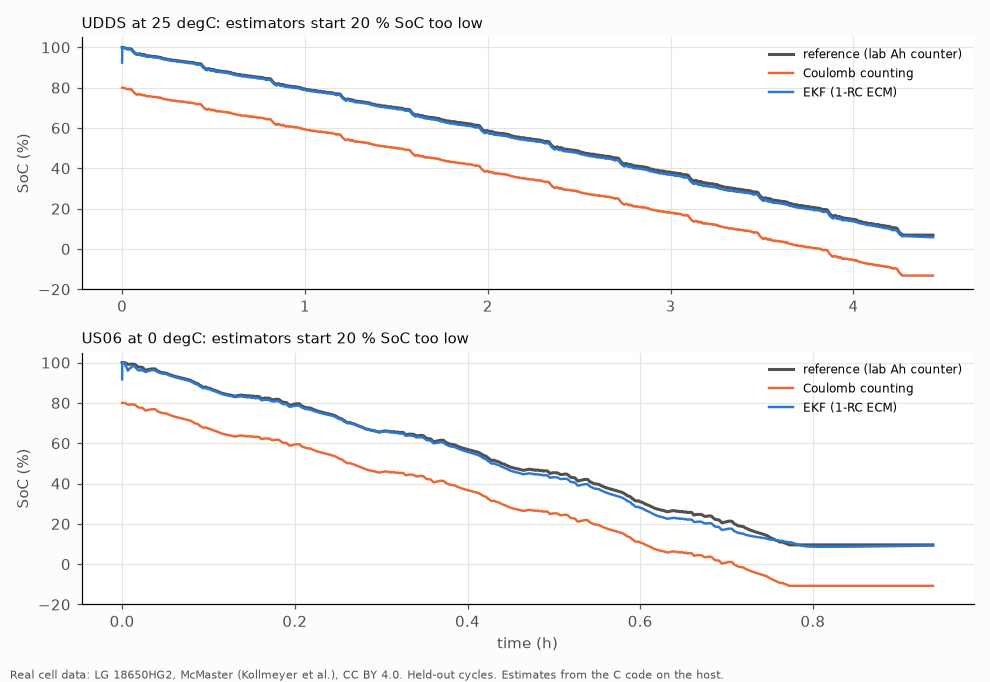

# motor-led-mw

Demo page: https://huggingface.co/spaces/pavanyadava07/motor-led-mw

Reusable C middleware for a small automotive motor + LED node, integrated on Zephyr with
TrustZone (TF-M), an Ethernet stack and PSA Crypto, plus an AI agent that writes the unit tests
and runs them on the target. Test quality is measured by mutation testing on the emulated
target, not by "the agent wrote tests".

Everything runs in QEMU on a cloud VM (Arm MPS2 boards). No real board, motor or LED was used:
the motor and the LED board are simple software models (see "Limits").

Since v0.2.0 the repo also holds a **battery management (BMS) module** in `bms/`: cell monitoring with
latched faults, a contactor state machine with precharge, SoC estimation (Coulomb counting + EKF) validated
on real cell test data, passive balancing, E2E-protected CAN frames with a DBC, requirements traceability,
profiling on an emulated Cortex-M4F and CI. See [BMS module](#bms-module).

## What is in it

| Part | What it does | Where |
|---|---|---|
| `mlmw/` middleware | Plain C99, no OS headers, no dynamic memory. LIN 2.x protected id and classic/enhanced checksum; six-step BLDC block commutation (hall decode, gate pattern, speed from hall period, ramp, PI with anti-windup, latched over-current and stall faults); RGB LED mixing (gamma, per-channel calibration, thermal derating); authenticated command frames with replay protection. Crypto is a callback, so the library stays portable. | `mlmw/include/mlmw/*.h` (the spec is in the header comments) |
| Node application | Zephyr 4.2 on `mps2/an521/cpu0/ns` (Cortex-M33). Zephyr runs non-secure, TF-M 2.2 runs secure. 1 kHz speed loop, 20 kHz hall commutation on a simulated motor, LED thermal model, telemetry every 100 ms. Commands arrive over UDP on the LAN9118 Ethernet model; the 8-byte AES-128 CMAC tag is checked with PSA Crypto inside TF-M, and the key lives in TF-M Internal Trusted Storage. | `app/` |
| Target test harness | Builds any folder of ztest files with the middleware for `mps2/an385` (Cortex-M3), runs it in QEMU and parses the result. | `tools/target.py`, `tests/harness/` |
| Mutation testing | Generates every single-change mutant of `mlmw/src/*.c` (operator swaps, constants +-1, statement deletion), drops mutants that do not compile or whose object code equals the original, and runs a suite against each mutant on the target. | `tools/mutate.py` |
| Test agent | A local code model writes one ztest file per module from the header and source. Three modes: `single` (one shot), `loop` (sees compiler errors and on-target failures, up to 4 fixes), `mutant` (also sees surviving mutants from a TRAIN half, 2 rounds). Scored on a HELD-OUT half it never sees. | `agent/agent.py` |
| Host client | Sends signed frames to the node and checks acks and telemetry. | `tools/node_client.py` |

## Results

All numbers come from files in `results/` and can be regenerated with the Makefile.

### Size on Cortex-M23

`tools/size_m23.py`, arm-none-eabi-gcc 13.3.1, `-mcpu=cortex-m23 -Os`: **1,030 bytes of code, 0 bytes of RAM data**,
largest stack frame 48 bytes (`results/size_m23.json`). Not counted: libgcc helpers for the 64-bit multiply in the
PI controller. Cortex-M23 is the core in Infineon's MOTIX TLE99xx and LITIX Interior parts; this is a compile-size
check only, nothing ran on those parts.

### Node demo (QEMU mps2-an521, TF-M + Zephyr)

`make app node`, then `make demo` (`results/node_demo.json`). Non-secure Zephyr image: 72.7 kB flash.

| Check over UDP | Expected | Result |
|---|---|---|
| set LED, set speed +2000 rpm | OK | OK |
| replay of the same frame | rejected (replay) | rejected |
| one tag bit flipped | rejected (MAC) | rejected |
| frame signed with a wrong key | rejected (MAC) | rejected |
| speed 5000 rpm (limit 3000) | rejected (argument) | rejected |
| unknown command | rejected (command) | rejected |
| reverse to -1500 rpm, stop, LED white | OK | OK |

10/10 checks pass. On the simulated motor, +2000 rpm settles within 5 % after 0.77 s of node time, the reversal to
-1500 rpm after 1.65 s, and stop brings it to 0. With the LED at full white the board model heats to 98 C and the
derating cuts the red duty from 65531 to 49559, which is what the formula in `led.h` gives. Acks come back in about
1.5 ms. These times are QEMU on a cloud VM, not hardware timings.

### Mutation testing and the test agent

`make mutants mutation-ref`, `make study report` (`results/mutants.json`, `results/ref_mutation.json`,
`results/agent/*/summary.json`, `results/summary.md`).

339 single-change mutants were generated from `mlmw/src/*.c`. 15 do not compile and 130 produce the same object code
as the original (equivalent), so **194 mutants** are used. They are split by a hash of their id into a TRAIN half (101),
which the agent may see in `mutant` mode, and a HELD-OUT half (93), which only the scoring uses.

The hand-written reference suite (30 tests in `tests/ref/`) kills **149 of 194 (76.8 %)**, 72 of the 93 held-out
mutants (77.4 %). Each suite runs on the emulated Cortex-M3 in about 0.5 s; a full mutation run takes under 3 minutes
with 12 parallel QEMU workers.

Agent study, 3 seeds per model, temperature 0.2, models served locally by Ollama (4-bit) on one NVIDIA L4:

| Model | Mode | Held-out mutants killed (mean +- sd) | Tests kept | Reference + agent, held-out |
|---|---|---|---|---|
| Qwen3-Coder 30B | single (one shot) | 34.0 % +- 8.2 | 31 | 81.7 % +- 1.1 |
| Qwen3-Coder 30B | loop (compiler + on-target feedback) | 46.2 % +- 2.1 | 38 | 82.4 % +- 0.6 |
| Qwen3-Coder 30B | mutant (+ surviving TRAIN mutants) | 49.5 % +- 7.5 | 44 | **82.8 % +- 0.0** |
| Qwen2.5-Coder 7B | single | 10.4 % +- 9.4 | 6 | 78.5 % +- 1.1 |
| Qwen2.5-Coder 7B | loop | 10.8 % +- 9.6 | 7 | 78.5 % +- 1.1 |
| Qwen2.5-Coder 7B | mutant | 10.8 % +- 9.6 | 7 | 78.5 % +- 1.1 |
| hand-written reference | - | 77.4 % | 30 | - |

What this shows:

- **On its own the agent is weaker than a hand-written suite** (best 49.5 % vs 77.4 %). No first-try file passed
  completely: the 30B model builds 92 % of its files first time but gets some expected values wrong when it works them
  out by hand from the header (LIN parity bits, CMAC frame layouts). Small tests matter: the cleanup removes a failing
  test, so one wrong number in a big test loses all its good checks.
- **On-target feedback is the step that helps most**: one shot to loop goes from 34.0 % to 46.2 % and the spread
  across seeds drops from 8.2 to 2.1 points. Mutant feedback adds a little more on average (49.5 %), with high variance.
- **Added to the hand-written suite, the agent's tests catch 5 of the 21 held-out mutants the hand suite missed, in
  every seed** (82.8 %). Three of them come up in all three seeds: an off-by-one in the LIN checksum loop that reads
  one byte past the buffer, a truncated reverse-commutation table, and an over-current debounce counter that is not
  reset. The other two differ by seed (a deleted clear-fault handler, a wrong sequence-number byte, a deleted LED
  calibration step, and others).
- The 7B model mostly fails to build (33 % of first-try files) and does not recover with feedback; at this size the
  agent loop does not pay off.

How the feedback works: the harness header `tests/harness/include/mlmw_test.h` gives `EXPECT_EQ(actual, expected)`,
which prints both values on failure. When a test fails on the current code, the agent sees the printed values and is
asked to recompute the expectation from the spec. So the final suites are regression tests of the current behaviour:
they protect what the code does now, and a spec bug that the agent accepts would need human review to catch.
Each agent run (30B) takes about an hour, 51 model calls and 150k output tokens.

## BMS module

Portable C99 battery management library for an N-series pack (default 12s of LG 18650HG2 cells, 10 ms cycle),
written like flight-software prototypes are: no dynamic memory, no recursion, no OS or libc calls, every
requirement traced to tests. All numbers below come from `results/bms/` (`make bms-all` regenerates them;
summary in `results/bms/RESULTS.md`, matrix in `results/bms/TRACE.md`).

| Part | What it does | Where |
|---|---|---|
| Monitoring | Per-cell over/under-voltage, over/under-temperature, charge/discharge over-current, each with a 3-sample debounce and latched faults; open sense wire, frozen (stuck) cell voltage under load and implausible temperature sensors are sensor faults and are kept out of the cell checks. | `bms/include/bms/bms_monitor.h` |
| Contactor state machine | INIT, STANDBY, PRECHARGE, ACTIVE, FAULT. Precharge closes only negative + precharge contactors; main positive closes at 95 % bus voltage; 500 ms precharge timeout; any latched fault opens all contactors in the same cycle; FAULT exits only on a reset request and only to STANDBY. | `bms_sm.h` |
| SoC | Coulomb counting plus an Extended Kalman Filter on a 1-RC equivalent circuit model with an OCV-SoC table. float32 only, no libm (own exp), so host and target give the same bits. | `bms_soc.h` |
| Balancing | Passive, start at 20 mV above the lowest cell, stop at 5 mV, floor 3.60 V, at most 4 bleeders, off with faults or discharge above 0.5 A. | `bms_balance.h` |
| CAN + E2E | BMS_Status, BMS_Faults, multiplexed BMS_CellV and the received VCU_Cmd, with CRC-8 SAE J1850 over a data id + payload and a 4-bit alive counter (AUTOSAR E2E style). The receiver discards CRC errors, repeated counters and counter jumps and times out after 100 ms. In ACTIVE a data-link loss keeps the contactors closed (no un-commanded loss of propulsion); cell faults still open them. | `bms_can.h`, `bms_e2e.h`, `bms/dbc/bms.dbc` |
| Requirements | 24 derived requirements in aircraft style, each linked to tests (`verifies:` tags) or to an analysis check on a results file. | `bms/requirements.yaml`, `bms/tools/trace.py` |

### SoC on real cell data (held-out drive cycles)

Data: McMaster University LG 18650HG2 tests by Kollmeyer, Vidal, Naguib and Skells (Mendeley Data,
doi:10.17632/cp3473x7xv.3, **CC BY 4.0**), downloaded by `bms/tools/fetch_data.py`. The ECM (OCV table, R0, R1, tau
per SoC) and the EKF noise were fitted on the **C/20 and HPPC tests only**. The drive cycles below were never used for
fitting or tuning. Reference SoC is the tester's Ah counter divided by the C/20 capacity. Both estimators run the
same C code; "start -20 %" means they start at 80 % when the cell is full.

| Held-out cycle | CC RMSE, start -20 % | EKF RMSE, start -20 % | EKF max error after 10 min | CC RMSE, -50 mA sensor offset | EKF RMSE, -50 mA sensor offset |
|---|---|---|---|---|---|
| UDDS, 25 degC | 20.01 | 0.86 | 1.43 | 4.62 | 1.47 |
| US06, 25 degC | 20.03 | 0.78 | 2.45 | 1.19 | 0.94 |
| LA92, 25 degC | 20.05 | 0.57 | 1.18 | 2.97 | 1.07 |
| Mixed1, 25 degC | 20.05 | 0.73 | 1.47 | 2.28 | 1.11 |
| Mixed2, 25 degC | 19.98 | 0.80 | 2.00 | 2.26 | 1.24 |
| UDDS, 0 degC | 20.03 | 2.97 | 4.21 | 4.36 | 3.40 |
| US06, 0 degC | 20.17 | 1.76 | 3.70 | 1.24 | 1.79 |
| LA92, 0 degC | 20.04 | 3.11 | 4.81 | 2.56 | 3.44 |
| HWFET, 0 degC | 20.00 | 4.67 | 6.62 | 1.54 | 4.68 |
| Mixed1, 0 degC | 20.00 | 3.20 | 5.07 | 2.08 | 3.55 |
| Mixed2, 0 degC | 19.97 | 3.14 | 4.85 | 2.20 | 3.53 |



What this shows:

- **The EKF removes a 20 % initial SoC error that Coulomb counting keeps for the whole cycle**: RMSE
  0.57 to 0.86 % at 25 degC and 1.76 to 4.67 % at 0 degC, against about 20 % for Coulomb counting.
- **At 0 degC the 1-RC model is the limit.** The EKF error after 10 minutes reaches 6.62 % (HWFET), so
  requirement BMS-REQ-015 (5 % after 10 minutes at 25 and 0 degC) is **not met** at 0 degC; the traceability matrix
  shows it as failing. With a correct start and a 50 mA current-sensor offset, the EKF beats Coulomb counting on all
  5 cycles at 25 degC but is worse on 5 of 6 cycles at 0 degC. A second RC pair, hysteresis and
  temperature-dependent parameters are the next steps.
- **Target parity: the C code on the emulated Cortex-M4F (QEMU mps2-an386, FPU) produces bit-identical results to
  the x86-64 host on all 8,118,504 float32 outputs** of these runs (`-ffp-contract=off`, no libm).

### Verification

| Check | Result | File |
|---|---|---|
| C unit tests, host (gcc) | 62 pass, also with ASan + UBSan | `host_tests.json` |
| Same tests as ztest on QEMU mps2-an385 (Cortex-M3, emulated, soft float) | 62 pass | `target_tests.json` |
| Fault injection (inside the suites) | open wire, stuck cell voltage, implausible NTC, CAN CRC error on every bit, frozen alive counter / replayed frame, counter jump, command timeout in STANDBY/PRECHARGE/ACTIVE, precharge timeout | `bms/tests/unit/` |
| DBC cross-check | C-packed frames decoded with cantools from `bms.dbc`, CRC vs an independent Python CRC: 8 pass | `host_tests.json` |
| Mutation score (operators of `tools/mutate.py`, equivalent mutants dropped by object-code hash) | **89.9 %** (597 of 664); 74.4 % before the detail tests written from the first run's survivors | `mutation.json` |
| Requirements | 24/24 covered, 23 passing; BMS-REQ-015 fails (0 degC SoC accuracy) | `TRACE.md` |
| Strict compile | 0 warnings with `-Wall -Wextra -Werror -pedantic -Wconversion -Wsign-conversion -Wshadow -Wdouble-promotion ...` on gcc and arm-none-eabi-gcc | `static_analysis.json` |
| cppcheck 2.13 `--enable=all` | 0 findings | `static_analysis.json` |
| cppcheck MISRA C 2012 addon | 20 findings open (rules 10.3 x9, 10.8 x7, 8.7 x2, 8.9 x1, 14.1 x1), recorded, not fixed | `static_analysis.json` |
| CI | GitHub Actions: strict build, unit tests, ASan/UBSan, pytest, cppcheck, ruff, traceability | `.github/workflows/bms.yml` |

### Profile (emulated Cortex-M4F)

`bms/tools/profile.py`, arm-none-eabi-gcc 13.3, 12 cells. Instruction counts come from a QEMU TCG plugin and are
**emulated instruction counts, not CPU cycles or time**.

| Item | Value |
|---|---|
| One BMS cycle (monitor + state machine + 12 EKF steps + balancing + 3 CAN frames + RX E2E), -O2 | **4,689.2 instructions** (6,701.2 with the first, bit-serial CRC) |
| One EKF step | 178.2 instructions |
| CRC/E2E per cycle | 543.0 instructions (2,555.0 bit-serial: the profile showed the CRC at 38 % of the cycle, a 16-entry nibble table fixed it for 16 bytes of ROM) |
| Code size (text incl. parameter tables), -Os | Cortex-M4F 4,282 B, Cortex-M33 4,266 B, Cortex-M3 4,482 B; 0 B data/bss |
| RAM context `bms_t` / worst-case stack of `bms_cycle()` | 620 B / 208 B (-Os, from `-fcallgraph-info=su`) |

### Limits

- **No real hardware**: the MCU is emulated (QEMU), there are no real cells in a pack, no AFE chip, no contactors,
  no CAN transceiver. Cell inputs in the unit tests are scripted; only the SoC study uses measured data, and that is
  one cylindrical cell from a lab tester, not an aircraft pack.
- Data: LG 18650HG2 from McMaster University (Kollmeyer et al.), CC BY 4.0. Two temperatures (25 and 0 degC),
  one parameter set per temperature (no interpolation between them). The reference SoC is itself Coulomb counting
  with the lab tester's 0.1 % current sensor. All drive cycles start from full charge at rest, which makes the
  EKF's start-up easy; a start from mid SoC under load is not covered by this data.
- The EKF does not model OCV hysteresis, a second RC pair, temperature inside a set, ageing or capacity fade,
  or cell-to-cell differences.
- Instruction counts are emulated, not cycles; timing on a real MCU (flash wait states, caches) will differ.
- **Not certified. Not DO-178C compliant and not DO-254/ARP4754A work.** It only borrows DO-178C-minded practices:
  written requirements, traceability to tests, structural checks (mutation testing), static analysis, deterministic
  numerics and reproducible results. The requirements are written for this demo, not taken from a real program.

## Run it

Needs: Linux, Docker, an NVIDIA GPU for the agent (tested on one L4), Arm GNU Toolchain 13.3, Python 3.11.

```bash
# one-time: Zephyr workspace (west, narrow module set) and the QEMU container
uv venv -p 3.11 ~/workspace/zephyr-ws/.venv && . ~/workspace/zephyr-ws/.venv/bin/activate
uv pip install west ninja && cd ~/workspace/zephyr-ws
git clone --depth 1 --branch v4.2.0 https://github.com/zephyrproject-rtos/zephyr
west init -l zephyr
west config manifest.project-filter -- '-.*,+cmsis,+cmsis_6,+mbedtls,+trusted-firmware-m,+mcuboot'
west update --narrow -o=--depth=1
uv pip install -r zephyr/scripts/requirements-base.txt -r modules/tee/tf-m/trusted-firmware-m/tools/requirements.txt
cd - && make qemu-image
# env.sh puts tools/bin/qemu-system-arm (runs zqemu:8.2) on PATH

make ref            # reference suite on the emulated Cortex-M3
make mutants mutation-ref
make app node       # terminal 1: boot the node
make demo           # terminal 2: signed commands over UDP
make ollama study report   # agent study (about 4 h on one L4)
make test lint      # host tests of the Python tooling

# BMS module
make bms-data       # ~150 MB of LG 18650HG2 CSVs from Mendeley Data (CC BY 4.0)
make bms-ci-image   # ubuntu 24.04 + gcc + cppcheck, same packages as CI
make bms-all        # host + target tests, SoC study, profile, mutation, static analysis, trace, report
make -C bms test    # only the host unit tests (needs gcc)
```

## Limits

- Emulation only: QEMU MPS2 boards, a LAN9118 Ethernet model and software models of the motor and LED board.
  Commutation, timing and current numbers say nothing about a real inverter.
- The node imports the demo key from firmware on first boot. A product would provision it at end of line.
- The 8-byte truncated CMAC with a 16-bit counter is a demo protocol, not a reviewed security design.
- The middleware is small on purpose. It is not MISRA-checked or ISO 26262 qualified.
- Mutation score depends on the operator set; mutants with identical object code are treated as equivalent, others
  may still be equivalent in behaviour.
- The agent study uses two local models (Qwen3-Coder 30B and Qwen2.5-Coder 7B, 4-bit) and three seeds each.

## Layout

```
mlmw/            middleware (include/ = spec, src/ = implementation)
app/             Zephyr + TF-M node for mps2/an521/cpu0/ns
tests/ref/       hand-written reference ztest suite
tests/harness/   generic ztest image for any test folder
tests/py/        host tests of the tooling
tools/           target runner, mutation testing, node client, size check, report
agent/           test-writing agent
bms/             battery management module (include/ = spec, src/, tests/, pil/, tools/, dbc/)
results/         every number in this README (BMS: results/bms/)
```

Licence: MIT.
