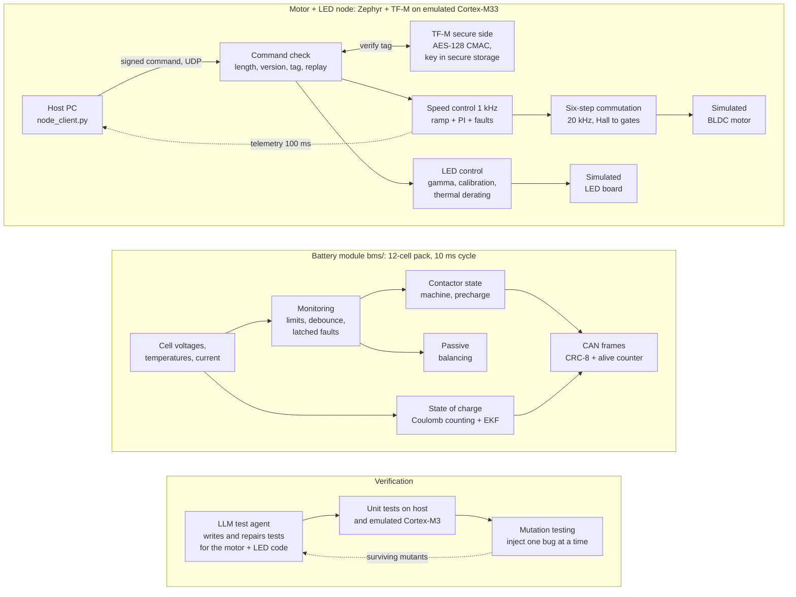
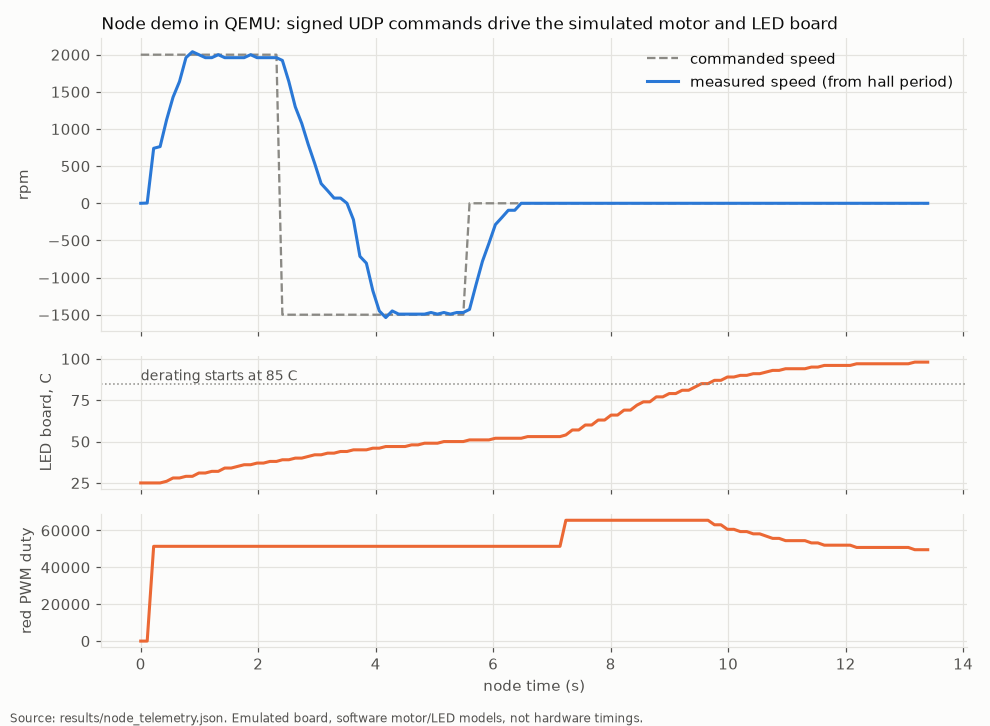
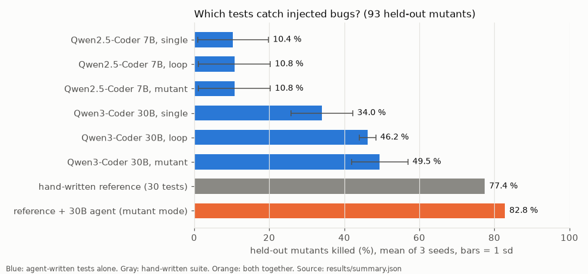
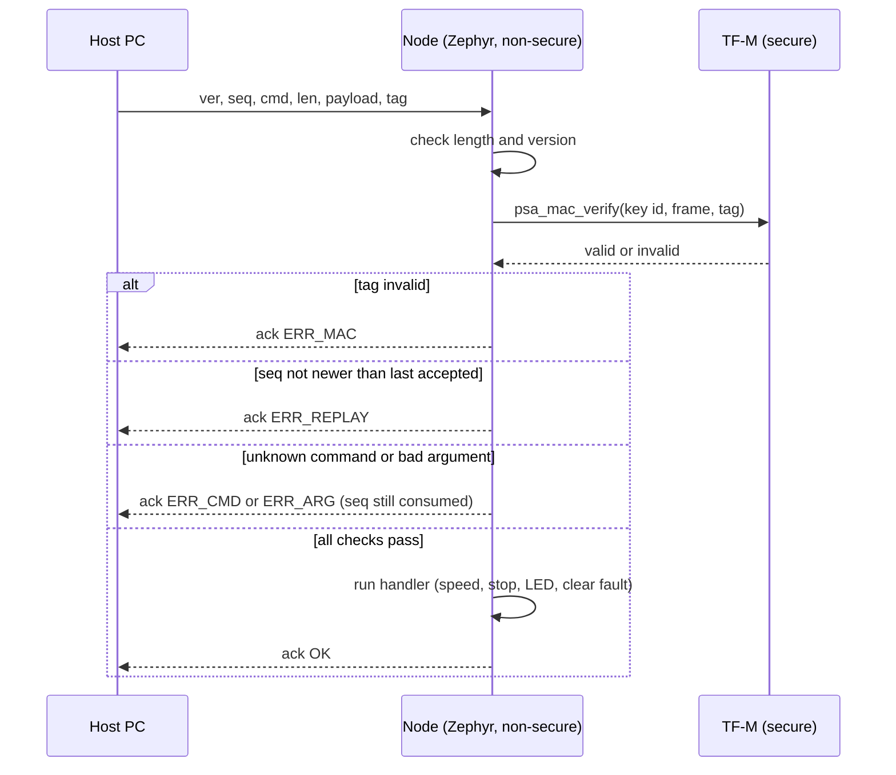
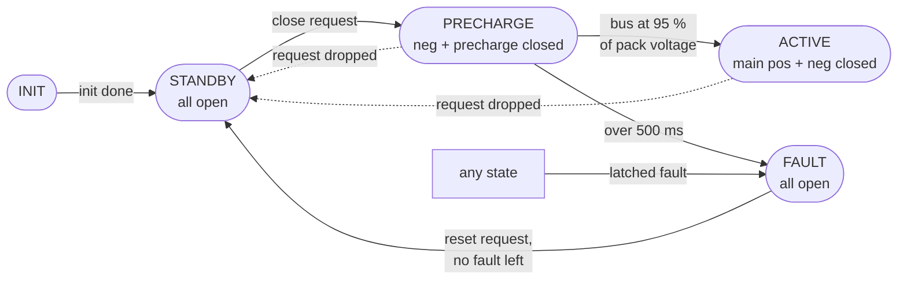
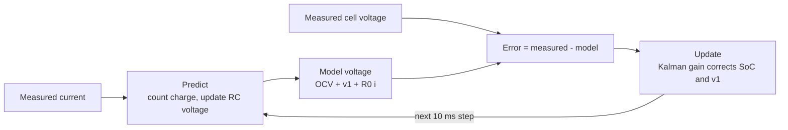
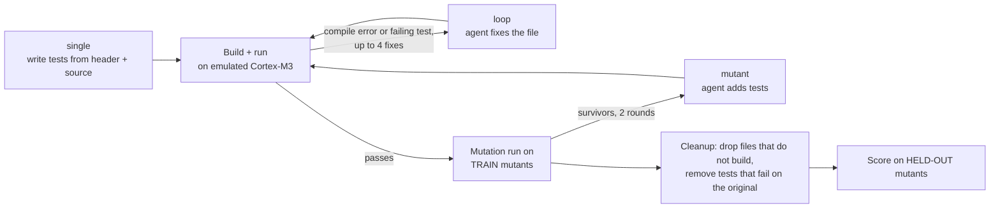

# motor-led-mw

Small embedded C software for a car-style electronic control unit: it drives a brushless motor and an RGB LED,
accepts only cryptographically signed commands, estimates a battery's state of charge, and proves with
mutation testing that its tests really catch bugs. Everything runs on emulated Arm microcontrollers (QEMU).

[](https://github.com/pavanyadava007/motor-led-mw/actions/workflows/bms.yml)

- Live demo page: https://huggingface.co/spaces/pavanyadava007/motor-led-mw
- Detailed result files: [results/summary.md](results/summary.md) (test agent study),
  [results/bms/RESULTS.md](results/bms/RESULTS.md) (battery module), [results/bms/TRACE.md](results/bms/TRACE.md)
  (requirements to tests)
- Change history: [CHANGELOG.md](CHANGELOG.md)

## In one picture



The motor + LED node and the battery module are two separate pieces of software in the same repository. They share
the same coding rules (plain C99, no dynamic memory) and the same verification approach. The battery module is not
wired into the node.

## What problem does this solve?

Modern cars contain many small control units that switch motors (seats, pumps, fans) and lights. Their software has to
be small, predictable, and safe against forged commands. Battery packs also need software that watches every cell and
estimates how much charge is left, even when the start value is wrong. This repo builds both kinds of software in
portable C, runs them on emulated Arm chips, and then checks the tests themselves: it plants hundreds of small bugs
in the code and measures how many the tests catch. It also tries a local AI model as a test writer and scores it
on bugs it has never seen.

## Key results

All numbers come from files in `results/` and can be regenerated with the Makefile.

| Result | What it means | Source |
|---|---|---|
| **1,030 bytes** of code, 0 bytes of RAM data (motor + LED + LIN + command library, Cortex-M23, `-Os`) | The middleware fits into very small automotive chips | [results/size_m23.json](results/size_m23.json), `tools/size_m23.py` |
| **10/10** protocol checks pass on the emulated node | Valid signed commands work; replayed, tampered, wrong-key, out-of-range and unknown frames are rejected | [results/node_demo.json](results/node_demo.json), `tools/node_client.py` |
| +2000 rpm reached within 5 % after **0.77 s** of node time | The speed loop settles on the simulated motor (not a hardware timing) | [results/node_demo.json](results/node_demo.json) |
| Hand-written tests kill **149 of 194** mutants (**76.8 %**) | 3 in 4 planted bugs in the middleware are caught by the 30 reference tests | [results/ref_mutation.json](results/ref_mutation.json), `tools/mutate.py` |
| AI agent alone: **49.5 %** of held-out mutants; reference + agent: **82.8 %** | The agent is weaker than a human suite, but adds 5 of the 21 bugs the human suite missed, in every seed | [results/summary.md](results/summary.md), `agent/agent.py` |
| Battery SoC error (RMSE) with a 20 % wrong start: EKF **0.57 to 0.86 %** at 25 degC, **1.76 to 4.67 %** at 0 degC; Coulomb counting about **20 %** | The Kalman filter corrects a wrong start value on real cell data; plain charge counting cannot | [results/bms/RESULTS.md](results/bms/RESULTS.md), `bms/tools/soc_eval.py` |
| **8,118,504** float outputs bit-identical on emulated Cortex-M4F and x86-64 host | Host results can be trusted for the target | [results/bms/RESULTS.md](results/bms/RESULTS.md) |
| Battery module: **62** unit tests pass (host, ASan/UBSan, emulated Cortex-M3), mutation score **89.9 %** | The battery code is tested on the host and on the emulated target, and the tests catch 9 in 10 planted bugs | [results/bms/host_tests.json](results/bms/host_tests.json), [results/bms/mutation.json](results/bms/mutation.json) |
| One full battery cycle: **4,689** emulated instructions, **4,282 B** code (Cortex-M4F, `-Os`) | Light enough for a small MCU (instruction counts are emulated, not CPU cycles) | [results/bms/profile.json](results/bms/profile.json), `bms/tools/profile.py` |
| **24/24** requirements traced to tests, **23** pass | One requirement (SoC accuracy at 0 degC) fails, and this is reported, not hidden | [results/bms/TRACE.md](results/bms/TRACE.md) |






Figures: `python tools/make_figures.py` draws the first two from `results/node_telemetry.json` and
`results/summary.json`; `bms/tools/soc_eval.py` draws the third.

## Algorithms used

| Area | Algorithm | Source |
|---|---|---|
| Motor | Six-step (block) commutation from Hall sensors | [mlmw/src/bldc.c](mlmw/src/bldc.c) |
| Motor | Speed from Hall edge period | [mlmw/src/bldc.c](mlmw/src/bldc.c) |
| Motor | Setpoint ramp + fixed-point PI controller with anti-windup | [mlmw/src/bldc.c](mlmw/src/bldc.c), [app/src/main.c](app/src/main.c) |
| Motor | Over-current debounce and stall detection, latched | [mlmw/src/bldc.c](mlmw/src/bldc.c) |
| LED | Gamma 2.0 colour mixing, per-channel calibration, linear thermal derating | [mlmw/src/led.c](mlmw/src/led.c) |
| Bus | LIN 2.x protected identifier (parity) and checksum | [mlmw/src/lin.c](mlmw/src/lin.c) |
| Security | AES-128 CMAC (truncated to 8 bytes) + sequence counter against replay | [mlmw/src/cmd.c](mlmw/src/cmd.c), [app/src/mac_psa.c](app/src/mac_psa.c) |
| Battery | Cell monitoring with debounce, latched faults, sensor plausibility | [bms/src/bms_monitor.c](bms/src/bms_monitor.c) |
| Battery | Contactor state machine with precharge | [bms/src/bms_sm.c](bms/src/bms_sm.c) |
| Battery | Coulomb counting + Extended Kalman Filter on a 1-RC equivalent circuit model | [bms/src/bms_soc.c](bms/src/bms_soc.c) |
| Battery | Model fitting (least squares) on lab test data | [bms/tools/fit_ecm.py](bms/tools/fit_ecm.py) |
| Battery | Passive balancing with hysteresis | [bms/src/bms_balance.c](bms/src/bms_balance.c) |
| Battery | CRC-8 SAE J1850 (nibble table) + 4-bit alive counter (AUTOSAR E2E style) | [bms/src/bms_e2e.c](bms/src/bms_e2e.c) |
| Testing | Mutation testing with equivalent-mutant filtering by object code | [tools/mutate.py](tools/mutate.py), [bms/tools/mutate_bms.py](bms/tools/mutate_bms.py) |
| Testing | LLM test agent with compile/run/mutant feedback loop | [agent/agent.py](agent/agent.py) |

### 1. Six-step BLDC commutation

**What it does.** A brushless motor has three coils (phases A, B, C). To make it turn, the controller must switch
the right pair of coils on at the right rotor position. Three Hall sensors tell it where the rotor is.

**How it works.** The 3 Hall bits form a code 1 to 6 (0 and 7 mean a broken sensor). The code maps to one of six
60-degree sectors, and each sector has one gate pattern: one phase high, one phase low, one floating. Reverse
swaps the high and low side.

| Hall code (A B C) | 1 | 3 | 2 | 6 | 4 | 5 |
|---|---|---|---|---|---|---|
| Sector | 0 | 1 | 2 | 3 | 4 | 5 |
| Forward: high / low | A / B | A / C | B / C | B / A | C / A | C / B |
| Reverse: high / low | B / A | C / A | C / B | A / B | A / C | B / C |

On the node this runs 20 times per millisecond (20 kHz) on the simulated motor. An invalid Hall code gives 0
(all gates off).

### 2. Speed measurement, ramp and PI speed control

**What it does.** Keeps the motor at the commanded speed without sudden jumps.

**How it works.** Speed comes from the time between two Hall edges (six edges per electrical turn):

```math
\text{rpm} = \frac{60 \cdot 10^{6}}{t_{\text{edge}}[\mu s] \cdot 6 \cdot p}
```

where $p$ is the number of pole pairs (2 in the motor model). Every 1 ms the setpoint moves toward the target by at
most 5 rpm (ramp), and a PI controller turns the speed error $e$ into a PWM duty (0 to 1000 per mille):

```math
I_k = \operatorname{clamp}\left(I_{k-1} + K_i e_k\right), \qquad u_k = \operatorname{clamp}\left(K_p e_k + I_k\right)
```

Gains are Q15 fixed point (on the node $K_p = 3277/32768 \approx 0.1$, $K_i = 655/32768 \approx 0.02$). Anti-windup:
the integrator is clamped to the output limits and does not grow while the output is already saturated in the
direction of the error. A reversal waits until the rotor is below 50 rpm.

**Fault monitor.** Current above 15 A for 5 consecutive 1 ms samples latches an over-current fault; no Hall edge for
200 ms while driving latches a stall fault. Faults stay set until a clear command.

### 3. LED colour mixing and thermal derating

**What it does.** Turns an RGB colour and a brightness into three 16-bit PWM duties, and dims the LEDs when the board
gets hot so they are not damaged.

**How it works.** For each channel $c$:

```math
\text{duty}_c = \gamma(\text{rgb}_c) \cdot \frac{\text{brightness}}{255} \cdot \text{gain}_c \cdot d(T),
\qquad \gamma(v) = \operatorname{round}\left(65535 \left(\frac{v}{255}\right)^{2}\right)
```

The derating factor $d(T)$ is 1 up to $T_{start}$, falls linearly to a minimum at $T_{max}$, and stays there. On
the node: $T_{start} = 85$ degC, $T_{max} = 125$ degC, minimum 0.25 (8192 in Q15). In the demo the board model
heats to 98 degC and the red duty drops from 65531 to 49559, exactly what this formula gives.

### 4. LIN 2.x protected identifier and checksum

**What it does.** LIN is a cheap single-wire car bus. Each frame id carries two parity bits, and each frame ends with
a checksum.

**How it works.** For the 6-bit id: $P_0 = ID_0 \oplus ID_1 \oplus ID_2 \oplus ID_4$ and
$P_1 = \lnot(ID_1 \oplus ID_3 \oplus ID_4 \oplus ID_5)$. The checksum is an 8-bit sum with carry wrap-around,
inverted. The "enhanced" checksum also adds the protected id, except for the diagnostic frames 0x3C and 0x3D,
which always use the classic checksum. These are library helpers; the demo node receives commands over Ethernet.

### 5. Authenticated commands: CMAC + replay protection

**What it does.** Makes sure the node only obeys commands from someone who holds the secret key, and that an old
recorded command cannot be sent again.

**How it works.** Frame: `ver(1) | seq(2) | cmd(1) | len(1) | payload | tag(8)`. The tag is an AES-128 CMAC over all
bytes before it, truncated to 8 bytes. The middleware does no crypto itself: it calls a verify callback. On the node
that callback calls PSA Crypto inside TF-M (the TrustZone secure side), and the key lives in TF-M Internal Trusted
Storage, so the non-secure application only ever holds a key id. A frame is accepted only if its 16-bit sequence
number is greater than the last accepted one.



Checks run in a fixed order: length, version, tag, replay, command, arguments. A frame that fails any check calls no
handler.

### 6. Battery cell monitoring

**What it does.** Watches every cell voltage, temperature and the pack current, and trips on unsafe values.

**How it works.** Strict limits (default 12-cell pack: over 4.20 V, under 2.80 V, above 60 degC, below -20 degC,
discharge above 20 A, charge above 6 A). A fault latches only after 3 consecutive bad samples (one good sample
resets the count), so a single noise spike does not trip the pack. Plausibility checks run first: a voltage outside
0.5 to 5.0 V is an open sense wire, a temperature outside -40 to 125 degC is a broken sensor, and a cell voltage
that does not change at all for 1 s under load is a stuck sensor. Sensor faults are kept out of the cell checks.

### 7. Contactor state machine with precharge

**What it does.** Connects the battery to the vehicle safely. Closing the main switch straight onto an empty
capacitor would cause a large current spike, so the bus is first charged through a resistor.



Any latched fault opens all contactors in the same 10 ms cycle, from any state.

### 8. State of charge: Coulomb counting + Extended Kalman Filter

**What it does.** Estimates how full each cell is (0 to 100 %). Simple charge counting drifts and never corrects a
wrong start value. The Kalman filter compares a cell model with the measured voltage and pulls the estimate back.

**Coulomb counting.** Integrate the current $i$ (positive = charge, in A) over the step $\Delta t$ (s), with
capacity $Q$ in Ah:

```math
\text{soc}_{k+1} = \text{soc}_k + \frac{i_k \, \Delta t}{3600 \, Q}
```

**Cell model (1-RC equivalent circuit).** One resistor $R_0$ for the instant voltage drop, one RC pair
($R_1$, $\tau$) for the slow relaxation, and an open-circuit voltage curve $\text{OCV}(\text{soc})$:

```math
v_{1,k+1} = a \, v_{1,k} + R_1 (1 - a) \, i_k, \qquad a = e^{-\Delta t / \tau}, \qquad
v_k = \text{OCV}(\text{soc}_k) + v_{1,k} + R_0 \, i_k
```

OCV is a 21-point table, and $R_0$, $R_1$, $\tau$ are 11-point tables over SoC (linear interpolation).

**EKF.** State $x = [\text{soc}, v_1]^T$. Each 10 ms step:

```math
\text{Predict:}\quad \hat{x}^- = f(\hat{x}, i), \qquad F = \begin{bmatrix} 1 & 0 \\ 0 & a \end{bmatrix}, \qquad
P^- = F P F^T + \begin{bmatrix} q_{soc} & 0 \\ 0 & q_{v1} \end{bmatrix}
```

```math
\text{Update:}\quad H = \begin{bmatrix} \frac{d\,\text{OCV}}{d\,\text{soc}} & 1 \end{bmatrix}, \qquad
K = \frac{P^- H^T}{H P^- H^T + r_v}, \qquad
\hat{x} = \hat{x}^- + K \left(v_{meas} - v_{pred}\right), \qquad P = P^- - K H P^-
```

After the update the SoC is clamped to 0..1. The pack SoC is the lowest cell SoC.



**Implementation details.** float32 only, no `libm` (own `exp` by range halving and a Taylor series), and
`-ffp-contract=off`, so host and target produce the same bits.

**Fitting.** [bms/tools/fit_ecm.py](bms/tools/fit_ecm.py) builds the OCV table from the slow C/20 discharge and HPPC
rest points, fits $R_0$, $R_1$, $\tau$ to the HPPC pulse test with `scipy.optimize.least_squares`, and picks the
noise values $r_v$, $q_{soc}$ from a small grid on the HPPC record. The drive cycles used for scoring were never used
for fitting or tuning. Data: LG 18650HG2 cell tests from McMaster University (Kollmeyer et al., Mendeley Data,
doi:10.17632/cp3473x7xv.3, CC BY 4.0).

### 9. Passive balancing

**What it does.** Cells drift apart over time. A small resistor bleeds charge from cells that are higher than the
lowest one.

**How it works.** Threshold with hysteresis: a bleeder turns on when a cell is at least 20 mV above the lowest cell
and stays on while the gap is above 5 mV. No balancing below 3.60 V, with a latched fault, or when discharging above
0.5 A. At most 4 bleeders run at once (board heat limit); cells already bleeding keep priority.

### 10. CAN end-to-end protection (CRC-8 + alive counter)

**What it does.** Detects corrupted, repeated, lost or misrouted CAN messages between the battery module and the
vehicle controller.

**How it works.** Each 8-byte frame carries a CRC-8 SAE J1850 (polynomial 0x1D, init 0xFF, final XOR 0xFF) in byte 0
and a 4-bit alive counter in byte 1. The CRC also covers a data id that is not sent, so a frame copied to the wrong
message id fails. The receiver reports CRC error, repeated counter (frozen sender) or a jump of more than 2 (lost
frames), and a timeout after 100 ms without a good frame. A 16-entry nibble lookup table replaced the bit-by-bit CRC
after profiling showed the CRC at 38 % of the battery cycle (543 instead of 2,555 emulated instructions per cycle).
Message layout: [bms/dbc/bms.dbc](bms/dbc/bms.dbc).

### 11. Mutation testing

**What it does.** Measures test quality. A test suite that passes is not proof of anything; a suite that fails when
the code is wrong is.

**How it works.** A *mutant* is a copy of the code with one small change, like a real typo:

```c
if (sector < 0 || sector > 5)     // original
if (sector < 0 || sector >= 5)    // mutant: relational operator swapped
```

Operators: relational and logical operator swaps, arithmetic and shift swaps, removing `!`, integer constants +1/-1,
deleting a statement. Mutants that do not compile are dropped, and so are mutants whose compiled object code is
identical to the original (they cannot change behaviour). The suite runs against every remaining mutant; a mutant is
*killed* when a test fails, crashes or times out.

```math
\text{mutation score} = \frac{\text{killed mutants}}{\text{non-equivalent mutants}}
```

Middleware: 339 candidates, 15 do not compile, 130 equivalent, so 194 used, each run on the emulated Cortex-M3
(12 QEMU workers in parallel). Battery module: 664 non-equivalent mutants, run on the host with the same test
sources.

### 12. LLM test-writing agent

**What it does.** A local code model (Qwen3-Coder 30B or Qwen2.5-Coder 7B, 4-bit, served by Ollama) writes one Zephyr
ztest file per module, from the header (the spec) and the source.

**How it works.** The 194 mutants are split by a SHA-1 hash of their id into a TRAIN half (101) and a HELD-OUT half
(93). The agent may see TRAIN survivors; it is scored only on HELD-OUT.



After each stage (single, loop, mutant) the current files go through the cleanup and are scored, so one run gives
three scores. The repair loop keeps the best version seen (builds, most passing tests), so a bad repair never loses
a working file.

## Architecture / repo layout

```
mlmw/            motor + LED middleware, plain C99 (include/ = spec in header comments, src/ = code)
app/             Zephyr 4.2 + TF-M node for mps2/an521/cpu0/ns: control loop, UDP network, PSA CMAC, motor/LED models
tests/ref/       hand-written reference ztest suite (30 tests)
tests/harness/   generic ztest image that runs any test folder on the emulated Cortex-M3
tests/py/        host tests of the Python tooling
agent/           LLM test-writing agent
tools/           QEMU target runner, mutation testing, node client, size check, report, figures, demo site
bms/             battery module: include/ (spec), src/, tests/, pil/ (target runs), tools/, dbc/, requirements.yaml
results/         every number in this README (battery module: results/bms/)
.github/         CI workflow for the battery module and Python lint
```

## How to run

**Quick start (only gcc and Python 3 needed): battery module unit tests**

```bash
make -C bms test
```

**Full setup.** Needs Linux, Docker, the Arm GNU Toolchain 13.3, Python 3.11, and an NVIDIA GPU for the agent
(tested on one L4).

```bash
# one-time: Zephyr workspace (west, narrow module set) and the QEMU container
uv venv -p 3.11 ~/workspace/zephyr-ws/.venv && . ~/workspace/zephyr-ws/.venv/bin/activate
uv pip install west ninja && cd ~/workspace/zephyr-ws
git clone --depth 1 --branch v4.2.0 https://github.com/zephyrproject-rtos/zephyr
west init -l zephyr
west config manifest.project-filter -- '-.*,+cmsis,+cmsis_6,+mbedtls,+trusted-firmware-m,+mcuboot'
west update --narrow -o=--depth=1
uv pip install -r zephyr/scripts/requirements-base.txt -r modules/tee/tf-m/trusted-firmware-m/tools/requirements.txt
cd - && make qemu-image
# env.sh puts tools/bin/qemu-system-arm (runs zqemu:8.2) on PATH

make ref            # reference suite on the emulated Cortex-M3
make mutants mutation-ref
make app node       # terminal 1: boot the node
make demo           # terminal 2: signed commands over UDP
make ollama study report   # agent study (about 4 h on one L4)
make test lint      # host tests of the Python tooling

# battery module
make bms-data       # ~150 MB of LG 18650HG2 CSVs from Mendeley Data (CC BY 4.0)
make bms-ci-image   # ubuntu 24.04 + gcc + cppcheck, same packages as CI
make bms-all        # host + target tests, SoC study, profile, mutation, static analysis, trace, report
```

`make help` lists every target.

## Tests and quality

| What | Result | Where |
|---|---|---|
| Middleware reference suite (ztest, emulated Cortex-M3) | 30 tests; kill 149 of 194 mutants (76.8 %) | [tests/ref/src/](tests/ref/src/), [results/ref_mutation.json](results/ref_mutation.json) |
| Node end-to-end demo over UDP (emulated Cortex-M33, TF-M) | 10/10 checks | [results/node_demo.json](results/node_demo.json) |
| Battery unit tests, host gcc | 62 pass, also with ASan + UBSan | [results/bms/host_tests.json](results/bms/host_tests.json) |
| Same battery tests as ztest on emulated Cortex-M3 (soft float) | 62 pass | [results/bms/target_tests.json](results/bms/target_tests.json) |
| Fault injection inside the battery tests | open wire, stuck cell voltage, implausible temperature sensor, CAN CRC error on every bit, frozen or jumping alive counter, command timeout, precharge timeout | [bms/tests/unit/](bms/tests/unit/) |
| DBC and CRC cross-checks (cantools, independent Python CRC) | 8 pass | [bms/tests/py/](bms/tests/py/) |
| Battery mutation score | 89.9 % (597 of 664); 74.4 % before tests were added for the first run's survivors | [results/bms/mutation.json](results/bms/mutation.json) |
| Requirements traceability | 24/24 covered, 23 pass, BMS-REQ-015 fails | [results/bms/TRACE.md](results/bms/TRACE.md) |
| Strict compile (`-Wall -Wextra -Werror -pedantic -Wconversion ...`), gcc and arm-none-eabi-gcc | 0 warnings | [results/bms/static_analysis.json](results/bms/static_analysis.json) |
| cppcheck 2.13 `--enable=all` | 0 findings | [results/bms/static_analysis.json](results/bms/static_analysis.json) |
| cppcheck MISRA C 2012 addon | 20 findings open (recorded, not fixed) | [results/bms/static_analysis.json](results/bms/static_analysis.json) |
| CI (GitHub Actions) | battery strict build, unit tests, ASan/UBSan, pytest, cppcheck, ruff, traceability. The Zephyr/QEMU parts and the agent study are not in CI (they need the toolchain image and a GPU) | [.github/workflows/bms.yml](.github/workflows/bms.yml) |

## Detailed results

### Node demo (QEMU mps2-an521, TF-M + Zephyr)

Non-secure Zephyr image: 72.7 kB flash. Median ack round trip 1.4 ms (QEMU on a cloud VM, not a hardware timing).

| Check over UDP | Expected | Result |
|---|---|---|
| set LED, set speed +2000 rpm | OK | OK |
| replay of the same frame | rejected (replay) | rejected |
| one tag bit flipped | rejected (MAC) | rejected |
| frame signed with a wrong key | rejected (MAC) | rejected |
| speed 5000 rpm (limit 3000) | rejected (argument) | rejected |
| unknown command | rejected (command) | rejected |
| reverse to -1500 rpm, stop, LED white | OK | OK |

On the simulated motor, +2000 rpm settles within 5 % after 0.77 s of node time, the reversal to -1500 rpm after
1.65 s, and stop brings it to 0.

### Test agent study

3 seeds per model, temperature 0.2, models served locally by Ollama (4-bit) on one NVIDIA L4. Held-out half: 93
mutants the agent never sees.

| Model | Mode | Held-out mutants killed (mean ± sd) | Tests kept | Reference + agent, held-out |
|---|---|---|---|---|
| Qwen3-Coder 30B | single (one shot) | 34.0 % ± 8.2 | 31 | 81.7 % ± 1.1 |
| Qwen3-Coder 30B | loop (compiler + on-target feedback) | 46.2 % ± 2.1 | 38 | 82.4 % ± 0.6 |
| Qwen3-Coder 30B | mutant (+ surviving TRAIN mutants) | 49.5 % ± 7.5 | 44 | **82.8 % ± 0.0** |
| Qwen2.5-Coder 7B | single | 10.4 % ± 9.4 | 6 | 78.5 % ± 1.1 |
| Qwen2.5-Coder 7B | loop | 10.8 % ± 9.6 | 7 | 78.5 % ± 1.1 |
| Qwen2.5-Coder 7B | mutant | 10.8 % ± 9.6 | 7 | 78.5 % ± 1.1 |
| hand-written reference | - | 77.4 % | 30 | - |

What this shows:

- **On its own the agent is weaker than a hand-written suite** (best 49.5 % vs 77.4 %). The 30B model builds 92 % of
  its files on the first try, but no first-try file passed completely: it gets some expected values wrong when it
  works them out by hand (LIN parity bits, CMAC frame layouts).
- **On-target feedback helps most**: one shot to loop goes from 34.0 % to 46.2 %, and the spread across seeds drops
  from 8.2 to 2.1 points. Mutant feedback adds a little more on average, with high variance.
- **Added to the hand-written suite, the agent's tests catch 5 of the 21 held-out mutants the hand suite missed, in
  every seed.** Three appear in all seeds: an off-by-one in the LIN checksum loop that reads one byte past the
  buffer, a truncated reverse-commutation table, and an over-current debounce counter that is not reset.
- The 7B model builds only 33 % of its first-try files and does not recover with feedback.
- The final suites are regression tests of the current behaviour: when a test fails, the agent recomputes the
  expectation from the printed values, so a spec bug that the agent accepts still needs human review.

Each 30B agent run takes about an hour, 51 model calls and about 150k output tokens.

### Battery SoC on held-out drive cycles (real cell data)

SoC error in % SoC. "start -20 %" means both estimators start at 80 % when the cell is really full.

| Held-out cycle | CC RMSE, start -20 % | EKF RMSE, start -20 % | EKF max error after 10 min | CC RMSE, -50 mA sensor offset | EKF RMSE, -50 mA sensor offset |
|---|---|---|---|---|---|
| UDDS, 25 degC | 20.01 | 0.86 | 1.43 | 4.62 | 1.47 |
| US06, 25 degC | 20.03 | 0.78 | 2.45 | 1.19 | 0.94 |
| LA92, 25 degC | 20.05 | 0.57 | 1.18 | 2.97 | 1.07 |
| Mixed1, 25 degC | 20.05 | 0.73 | 1.47 | 2.28 | 1.11 |
| Mixed2, 25 degC | 19.98 | 0.80 | 2.00 | 2.26 | 1.24 |
| UDDS, 0 degC | 20.03 | 2.97 | 4.21 | 4.36 | 3.40 |
| US06, 0 degC | 20.17 | 1.76 | 3.70 | 1.24 | 1.79 |
| LA92, 0 degC | 20.04 | 3.11 | 4.81 | 2.56 | 3.44 |
| HWFET, 0 degC | 20.00 | 4.67 | 6.62 | 1.54 | 4.68 |
| Mixed1, 0 degC | 20.00 | 3.20 | 5.07 | 2.08 | 3.55 |
| Mixed2, 0 degC | 19.97 | 3.14 | 4.85 | 2.20 | 3.53 |

- **The EKF removes a 20 % start error that Coulomb counting keeps for the whole cycle.**
- **At 0 degC the 1-RC model is the limit.** The EKF error after 10 minutes reaches 6.62 % (HWFET), so requirement
  BMS-REQ-015 (5 % after 10 minutes) is **not met** at 0 degC. With a correct start and a 50 mA current-sensor offset,
  the EKF beats Coulomb counting on all 5 cycles at 25 degC but is worse on 5 of 6 cycles at 0 degC. A second RC
  pair, hysteresis and temperature-dependent parameters are the next steps.

### Battery profile (emulated Cortex-M4F)

Instruction counts come from a QEMU plugin and are **emulated instruction counts, not CPU cycles or time**.

| Item | Value |
|---|---|
| One battery cycle (monitor + state machine + 12 EKF steps + balancing + 3 CAN frames + RX E2E), -O2 | 4,689.2 instructions (6,701.2 with the bit-serial CRC) |
| One EKF step | 178.2 instructions |
| Code size (text incl. parameter tables), -Os | Cortex-M4F 4,282 B, Cortex-M33 4,266 B, Cortex-M3 4,482 B; 0 B data/bss |
| RAM context / worst-case stack of `bms_cycle()` | 620 B / 208 B (-Os) |

## Limits

- **Emulation only.** QEMU MPS2 boards, a LAN9118 Ethernet model, and software models of the motor and the LED board.
  Commutation, timing and current numbers say nothing about a real inverter.
- **No battery hardware.** No real pack, no measurement chip, no contactors, no CAN transceiver. Cell inputs in the
  unit tests are scripted; only the SoC study uses measured data, from one cylindrical cell on a lab tester.
- **SoC model.** Two temperatures (25 and 0 degC), one parameter set each. No OCV hysteresis, no second RC pair, no
  ageing, no cell-to-cell differences. The reference SoC is itself the lab tester's charge counter. All drive cycles
  start from full charge at rest, which makes the EKF start-up easy.
- **Security.** The node imports a demo key from firmware on first boot; a product would provision it at end of line.
  The 8-byte truncated CMAC with a 16-bit counter is a demo protocol, not a reviewed security design.
- **Not certified.** The middleware is not MISRA-checked or ISO 26262 qualified. The battery module is not DO-178C
  compliant; it only borrows practices (written requirements, traceability, mutation testing, static analysis). Its
  requirements were written for this demo, not taken from a real program.
- **Mutation score** depends on the operator set. Mutants with identical object code are treated as equivalent;
  others may still behave the same.
- **Agent study** uses two local models and three seeds each.
- **Instruction counts** are emulated, not cycles; timing on a real MCU (flash wait states, caches) will differ.

## License

MIT, see [LICENSE](LICENSE). Cell test data: McMaster University LG 18650HG2 dataset (Kollmeyer, Vidal, Naguib,
Skells), CC BY 4.0, downloaded by `bms/tools/fetch_data.py`.
